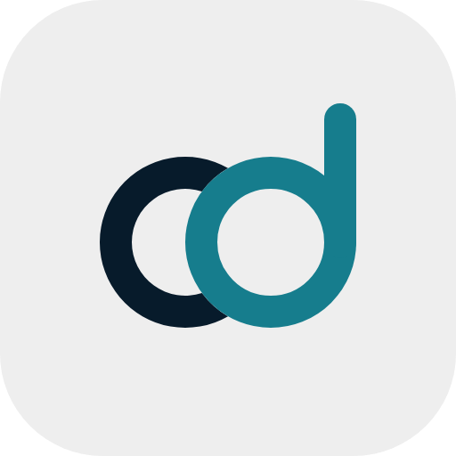

# Adle

**Learn at your own pace. Understand for real.**

Adle (Adaptive Learning Environment) is a local-first desktop app that learns what you understand
and teaches what you need next. Give it a topic or your own course materials; it builds a
curriculum you can inspect, teaches each concept with narrated, interactive visuals, checks your
understanding with short questions, and adapts the next step to what you have actually shown.

> **Status: early development.** In place: the desktop shell and design system, secure handling
> of the AI key, the isolated runtime for interactive scenes, courses with local document import
> and search, and an editable curriculum. Lessons and adaptation are being built next. See
> [`docs/engineering/PROJECT_STATE.md`](docs/engineering/PROJECT_STATE.md) for exactly what works.

## What works today

- The app starts without any account or key, explains what stays on your computer, and remembers
  that you have seen the welcome.
- Light and dark themes (or follow the system), keyboard navigation throughout.
- **Courses:** create a course from a topic or from your own materials.
- **Import** PDF, Word (.docx), Markdown, and text files by picking or dropping them. Adle shows
  what it extracted, warns about anything doubtful (for example scanned pages), and explains why
  a file was rejected.
- **Search your materials** and see the exact file and page or section each passage comes from.
- **Curriculum:** build the list of concepts a course teaches, by hand or starting from the
  headings of your materials. Give each one learning objectives, say what it needs first, and
  see the result as a list or a map. Adle keeps the order learnable and explains when it cannot
  do what you asked.
- **A sample course** you can add from the library with one click, without an AI key.
- **Lessons:** captions at your reading pace, a board that fills in as the lesson goes, live
  pictures you can pause, replay, try out, or read as a description, and questions that are
  explained whichever way you answer. A lesson remembers where you stopped, and tells you in
  words what your answers showed.
- **Settings → Learning:** pace, explanation depth, narration, captions, and your goal.
- **Settings → AI provider:** save or remove an AIHubMix key. It is encrypted by your operating
  system and never shown again.
- **Settings → About & diagnostics:** restart the local service and run a live check of the
  interactive visual runtime.

## Your data

- Course files, answers, and progress are stored only on your computer.
- One thing uses the internet: when you ask Adle to generate a course or lesson, the text needed
  for that request is sent to the AI provider you configured (AIHubMix by default). Nothing is
  sent before you add a key and ask.
- No accounts, no analytics, no telemetry, no crash uploads.

Details: [SECURITY.md](SECURITY.md).

## Run from source

Requirements: [Node.js](https://nodejs.org/) 22.12 or newer (24.3.0 is pinned), and
[uv](https://docs.astral.sh/uv/) for Python. Python 3.12 is installed by uv if missing.

```bash
npm run setup
```

```bash
npm run dev
```

`setup` installs the JavaScript dependencies, downloads the pinned Electron binary, and creates
the Python environment. `dev` builds the app, starts it, and restarts it when you change code.

Other commands:

| Command | What it does |
|---|---|
| `npm run build` then `npm start` | Build once and run the built app |
| `npm run check` | Format, lint, type-check, and run all unit tests (TypeScript and Python) |
| `npm run e2e` | Build and run the end-to-end tests in the real app |

Installers are not available yet; packaging is part of the release milestone.

## Configuration

| Setting | Where |
|---|---|
| AI provider key | Settings → AI provider |
| Theme | Settings → Appearance |
| Provider address and model | Shown in Settings → AI provider (`https://aihubmix.com/v1`, `coding-kimi-k3-free`). Editing arrives with lesson generation. |
| Use a separate data folder | Start with the environment variable `ADLE_USER_DATA_DIR` set to an empty folder |

The free AIHubMix model allows 5 requests per minute, 100 per day, and one million tokens per day
per account (as published on 2026-11-19; the provider's page is authoritative). Adle paces itself
below those limits.

## Troubleshooting

| Symptom | Try |
|---|---|
| "Local service needs attention" in the corner | Settings → About & diagnostics → **Restart service**. From source, make sure `npm run core:sync` has been run. |
| "Secure storage is unavailable" | Your system has no credential store Adle trusts (on Linux, install and unlock GNOME Keyring or KWallet). Everything that does not need AI still works. |
| A PDF is rejected as having no selectable text | It is a scan. Adle does not run text recognition (OCR) and never uploads files to do so. Convert it with an OCR tool first, or import the text in another format. |
| An import warns about skipped pages | Some pages had no text layer. The rest was imported, and the file is marked "Check extraction". |
| A visual does not appear | Settings → About & diagnostics → **Run check**. Lessons fall back to a text explanation when a visual cannot run. |
| Start completely fresh | Close Adle and delete its data folder (`%APPDATA%\Adle` on Windows, `~/Library/Application Support/Adle` on macOS, `~/.config/Adle` on Linux). This removes your courses and progress. |

Logs for the local service are written to `logs/core.log` inside the data folder. They do not
contain your key, your documents, or your answers.

## For contributors

Start with [AGENTS.md](AGENTS.md), then [CONTRIBUTING.md](CONTRIBUTING.md) and
[TESTING.md](TESTING.md). The product specification is [PLAN.md](PLAN.md).

## Licence

Not yet licensed for redistribution (`UNLICENSED`). Third-party components keep their own
licences; see `docs/decisions/ADR-001-stack-and-pins.md` and
`skills/wanim-scene-authoring/reference.md`.
