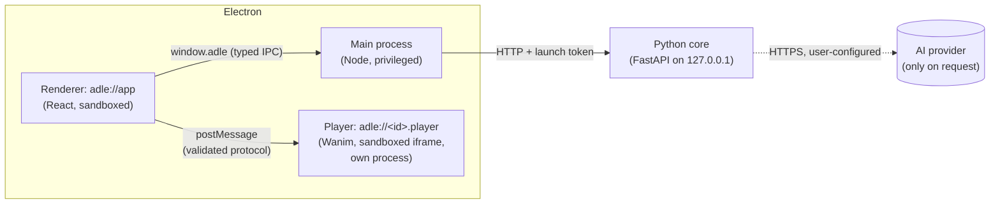
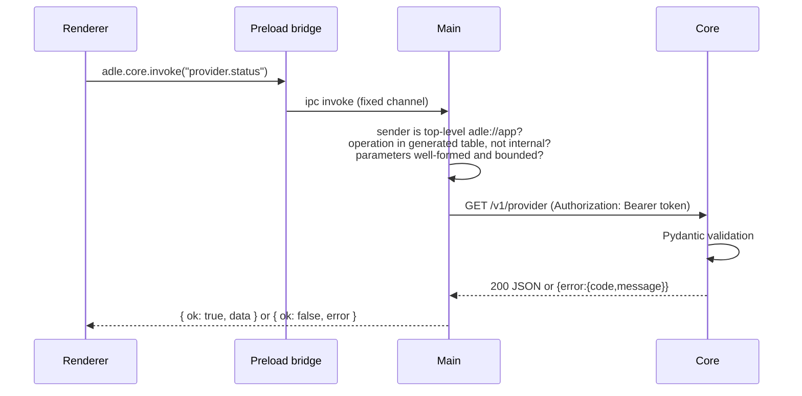
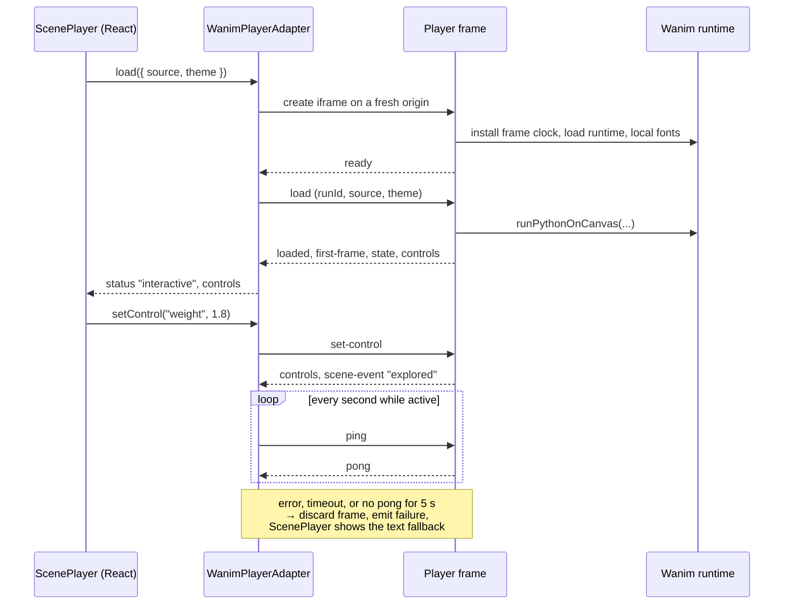
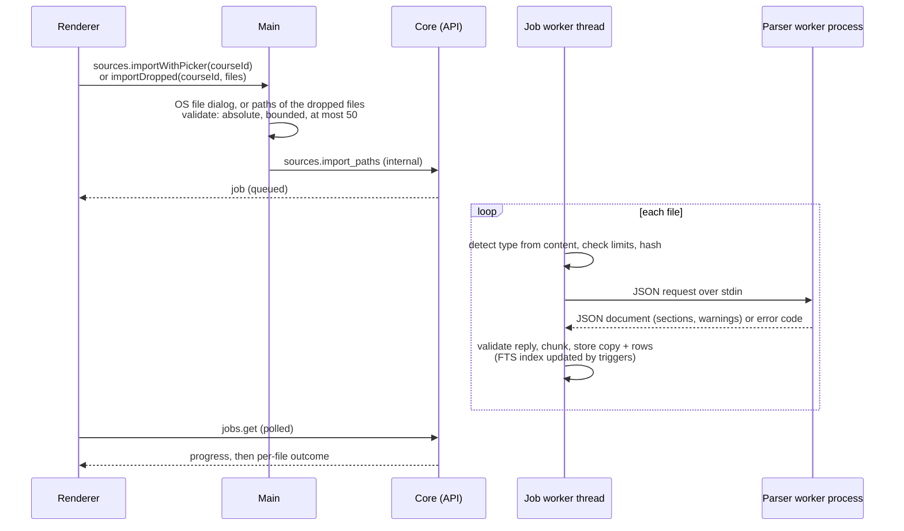

# Architecture overview

Adle is a modular monolith in four operating-system processes. This document describes what
exists today; milestones not yet built are listed in `PLAN.md` §16 and
`docs/engineering/PROJECT_STATE.md`.

## Processes and trust

| Process | Trust | May | May not |
|---|---|---|---|
| **Main** (`apps/desktop/electron/main`) | Trusted | Spawn the core, hold the token, read/write OS secure storage, serve app files | Execute scene code, hold learner data |
| **Renderer** (`apps/desktop/renderer`) | Trusted code, hostile-input-facing | Render UI, call allowlisted core operations | Use Node, the network, the filesystem, or see the provider key |
| **Player** (`apps/desktop/player/frame`) | **Untrusted** (runs generated code) | Draw on a canvas, post validated messages | Anything else |
| **Core** (`services/core`) | Trusted | Own the database and files, call the provider | Listen beyond loopback, persist the provider key |

## How a request travels

The operation table and the TypeScript types come from the core's OpenAPI document
(`npm run contracts`, ADR-005).

## Startup

1. Main registers the `adle` scheme, applies the saved theme, locks the session down (no network,
   no permissions, storage cleared), and opens the window on `adle://app/index.html`.
2. The renderer reads app info and UI state through the bridge and shows the welcome screen or the
   library. It is usable immediately.
3. In parallel, main starts the core (ADR-002). On `ready` it pushes the stored provider key to the
   core. Status changes are broadcast to the renderer.
4. On quit, main closes the core's stdin, waits for it to exit, then quits.

## Playing a scene

See ADR-004 for why the frame is arranged this way and `skills/wanim-scene-authoring/` for what a
scene may contain.

## Importing course materials

Text search (`sources.search`) reads the FTS5 index and returns each passage with its source,
page or heading path, and highlighted segments. See ADR-007.

## Data on disk

Everything lives under the profile directory (`ADLE_USER_DATA_DIR`, or the OS default):

| Path | Owner | Contents |
|---|---|---|
| `ui-state.json` | Main | Theme and whether the welcome was seen |
| `credentials.bin` | Main | The provider key, encrypted by the OS |
| `data/adle.db` (+ `-wal`, `-shm`) | Core | Courses, sources, sections, chunks, jobs, settings |
| `data/sources/<source id>.<ext>` | Core | A copy of each imported original, named by its generated id |
| `data/assets/` | Core | Reserved for generated lesson assets (M5) |
| `data/backups/` | Core | Automatic database copies made before a migration (five kept) |
| `logs/core.log` | Main | The core's log output (no document text, answers, or secrets) |

## Code map

| Path | Responsibility |
|---|---|
| `apps/desktop/electron/main` | App lifecycle, protocol, session hardening, core supervision, IPC handlers, key and UI-state storage |
| `apps/desktop/electron/preload` | The `window.adle` bridge: fixed channels only |
| `apps/desktop/electron/shared` | The IPC contract (channel names and types) |
| `apps/desktop/renderer` | React app: router, screens, core client, `ScenePlayer` |
| `apps/desktop/player/frame` | Code that runs inside the sandboxed frame: frame clock, scene run, control mirroring |
| `apps/desktop/player/host` | `WanimPlayerAdapter`: the only thing the app knows about the player |
| `apps/desktop/e2e` | Playwright tests against the built app |
| `packages/design-system` | Sprout tokens and components |
| `packages/event-protocol` | Host ↔ player message types, validators, and origin helpers |
| `packages/contracts` | Generated API types and operation table |
| `services/core/adle_core/api` | FastAPI app, auth, error contract, routes |
| `services/core/adle_core/application` | The service container; courses, sources (import and search), background jobs |
| `services/core/adle_core/infrastructure` | SQLite engine, ORM models, migrations with backup, asset store |
| `services/core/adle_core/ingestion` | Type detection, parsers, chunking, and the parser worker process |
| `services/core/adle_core/generation` | Provider credentials, scene policy (model client and quota manager arrive in M5) |
| `skills/wanim-scene-authoring` | How to write a scene; tested examples |

Layering rule for the core: `domain` depends on nothing; `application` and `generation` depend on
`domain`; `api` depends on all of them and contains no domain logic; `infrastructure` implements
interfaces that `domain` and `application` define.
