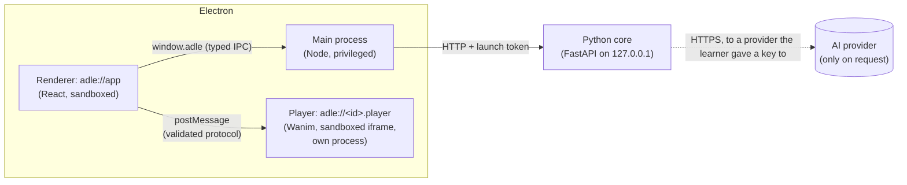
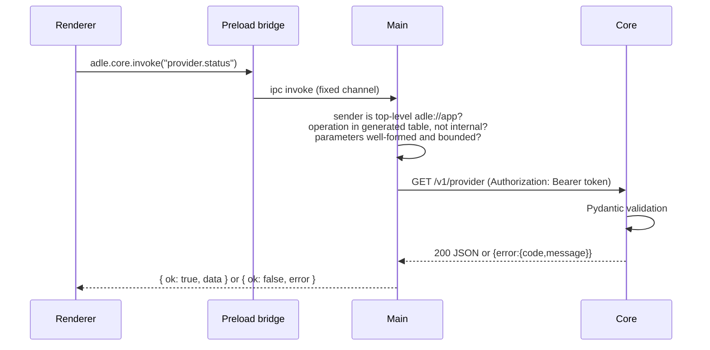
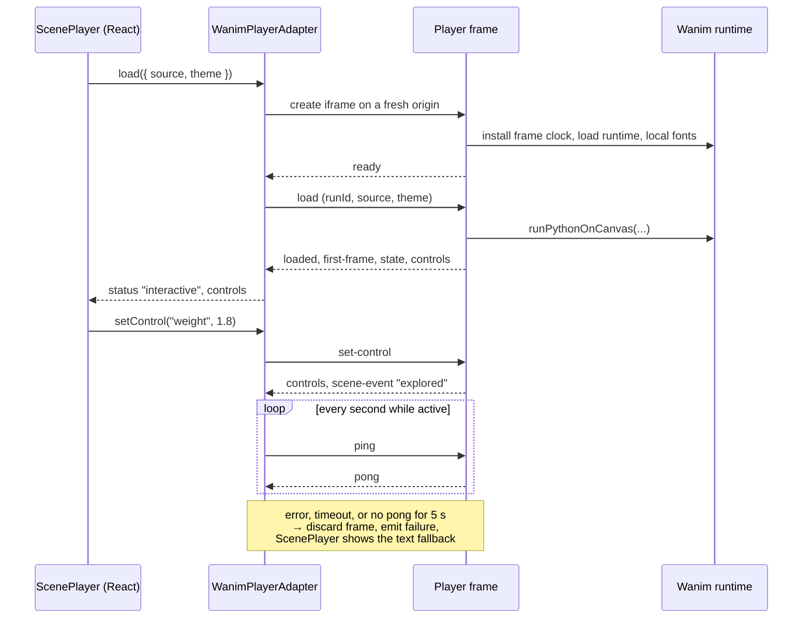
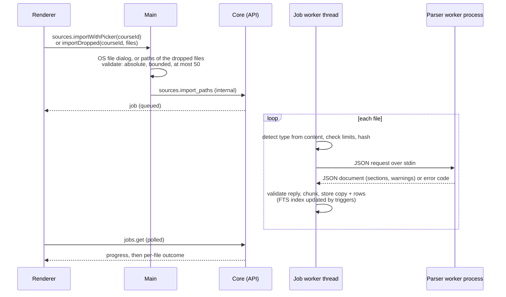
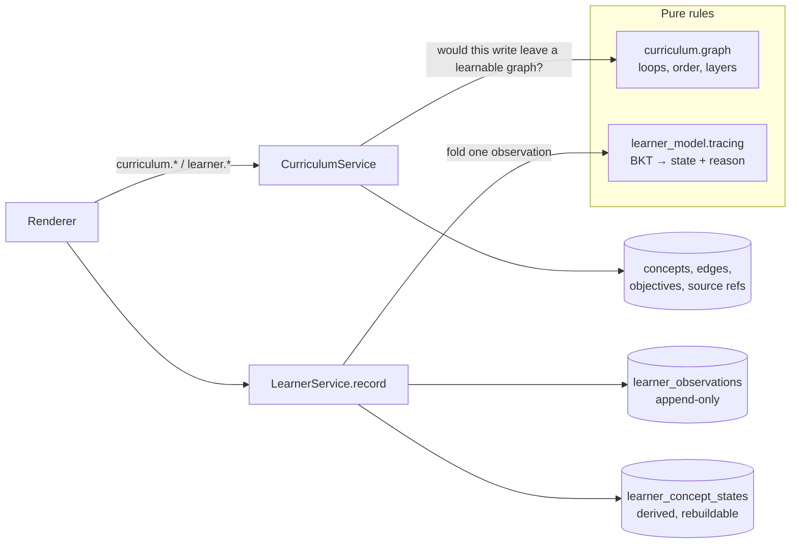
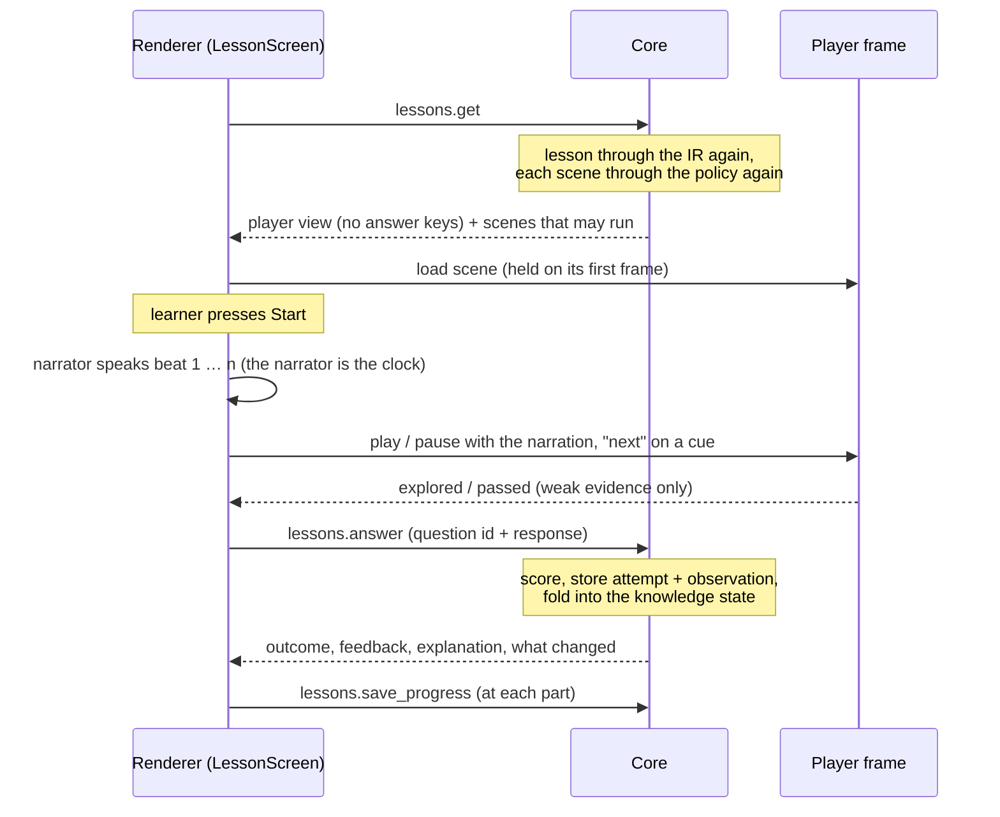
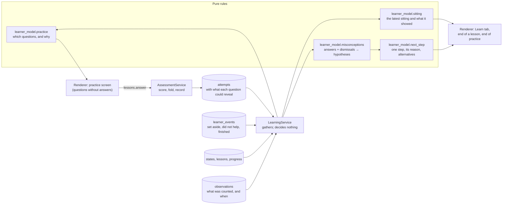
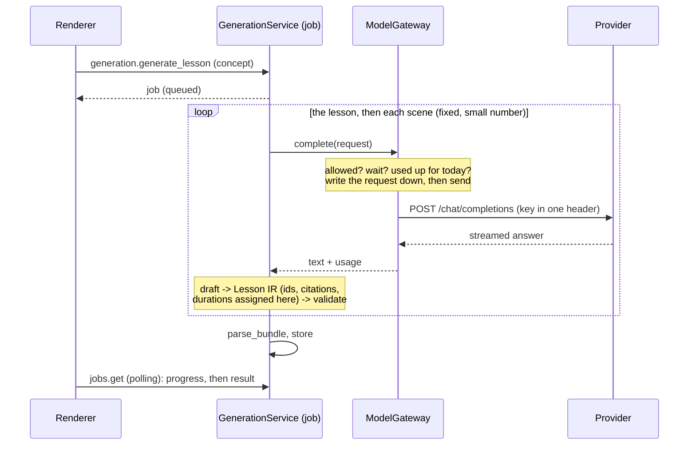

# Architecture overview

Adle is a modular monolith in four operating-system processes. This document describes what
exists today; milestones not yet built are listed in `PLAN.md` §16 and
`docs/engineering/PROJECT_STATE.md`.

## Processes and trust



| Process | Trust | May | May not |
|---|---|---|---|
| **Main** (`apps/desktop/electron/main`) | Trusted | Spawn the core, hold the token, read/write OS secure storage, serve app files | Execute scene code, hold learner data |
| **Renderer** (`apps/desktop/renderer`) | Trusted code, hostile-input-facing | Render UI, call allowlisted core operations | Use Node, the network, the filesystem, or see the provider key |
| **Player** (`apps/desktop/player/frame`) | **Untrusted** (runs generated code) | Draw on a canvas, post validated messages | Anything else |
| **Core** (`services/core`) | Trusted | Own the database and files, call a provider the learner gave a key to, as their choice allows | Listen beyond loopback, persist a provider key, change the learner's choice of provider |

## How a request travels



The operation table and the TypeScript types come from the core's OpenAPI document
(`npm run contracts`, ADR-005).

## Startup

1. Main registers the `adle` scheme, applies the saved theme, locks the session down (no network,
   no permissions, storage cleared), and opens the window on `adle://app/index.html`.
2. The renderer reads app info and UI state through the bridge and shows the welcome screen or the
   library. It is usable immediately.
3. In parallel, main starts the core (ADR-002). On `ready` it asks the core which providers
   there are and where, pushes the key stored for each at that address, and then the
   learner's choice: one provider, or "automatic" (`syncProviders`, ADR-021, ADR-023).
   Status changes are broadcast to the renderer.
4. On quit, main closes the core's stdin, waits for it to exit, then quits.

## Playing a scene



See ADR-004 for why the frame is arranged this way and `skills/wanim-scene-authoring/` for what a
scene may contain.

## Importing course materials



Text search (`sources.search`) reads the FTS5 index and returns each passage with its source,
page or heading path, and highlighted segments. See ADR-007.

## Curriculum and what the learner knows



- A course's concepts form a directed graph. Every write is checked first; a change that would
  close a loop is refused with the loop named. Reading validates again and reports problems.
- What a learner has shown about a concept is a list of observations. The state the interface
  shows (*Not assessed*, *Building understanding*, *Needs more evidence*, *Demonstrated for
  now*) is computed from them, with a sentence for each change. The numeric estimate behind it
  never leaves the core. See ADR-009.

## Taking a lesson



- The **Lesson IR** (`adle_core/lessons/ir.py`) is the one definition of a lesson. Whatever wrote
  it, a lesson is stored only through `parse_bundle`.
- The renderer's `LessonController` decides what is on screen; it takes its timing from a
  `Narrator`: a voice installed on the computer, or silent captions at reading pace
  (ADR-013).
- A learner can ask about the part in front of them (`lessons.ask`). That is a job in the
  quick lane; the answer is kept beside the part in `lesson_asks` (ADR-024).
- If a scene fails in the player, or the core withholds it, the part shows its description in
  words and the lesson continues.
- Answers are judged in the core. See ADR-010.
- Narration is read by a voice installed on the computer (`lesson/speech.ts`), or shown as text
  at reading pace. Either way the narrator is the lesson's clock. See ADR-013.

## Deciding what next



- A hypothesis about a mistake is never stored. It is computed from the answers and from what
  the learner set aside, every time, so it cannot disagree with the record.
- The next step is chosen by rules over states, counts, and dates. It comes with a reason and
  with alternatives, and the learner may ignore it.
- Practice and review answer through the same operation as a lesson's questions. There is one
  scoring path and one place where evidence is recorded. See ADR-014.
- A session is not stored either. The latest sitting (a run of activity with no long pause)
  is read off the observations and reported as counts of right answers, what is still
  missing, and the reviews planned: "This session" while it may still be going, "Last time"
  afterwards. See ADR-017.

## Asking the model



- The model writes a forgiving draft. The core compiles it into the Lesson IR, so no identifier
  or citation comes from the model.
- The gateway keeps a local count for each provider, under that provider's limits (or under
  Adle's own, where the provider publishes none). The interface shows it as an estimate.
- Requests go to a provider the learner gave a key to (AIHubMix or NVIDIA NIM), with that
  provider's key and no other. If they chose one provider, everything goes there. If they
  chose "automatic", `generation/routing.py` plans each request: what is waited for goes to
  the quick provider, long work to the roomy one once the quick one is half used for the
  day, and the next in the plan is asked when the first cannot answer. The interface is told
  the plan (`provider.status` → `routes`) and says it before anything is sent. See ADR-023.
- Where a provider has several models, the gateway asks the first; while that one is away
  it asks the next, at the same address with the same key. Every stand-in, model or
  provider, is said while it happens and kept in the record (`written_by`). See ADR-021.
- One request is in flight at each provider. Jobs run in two lanes: long work one at a
  time, and what the learner waits for (a question during a lesson, a check of a key)
  beside it.
- A request that is stopped is given up at once; the connection is let go the next time
  anything arrives on it.
- While an answer is on its way the job says what the model is doing ("thinking it
  through", "writing"): these models think for a minute or more before the first word.
- A curriculum proposal works the same way, in one request, and adds nothing until the learner
  has chosen from it. See ADR-012.

## Reading and writing the database

Every unit of work is one of two kinds. One that may write (`Database.session()`) takes
SQLite's write lock when it begins, so writers queue instead of colliding. One that only reads
(`Database.read()`) runs on connections that cannot write; it sees a consistent snapshot and
never waits. The interface's polling and first loads are reads, so a job that is writing never
holds the screen up. See ADR-015.

## The data as a whole: copy, restore, delete

Three actions in Settings → Privacy & data act on everything at once (ADR-016). The page asks
for one with `window.adle.data.*`, which takes no arguments; the main process asks the learner
the question that goes with it in a window of the operating system.

- **Save a copy.** Main opens a save dialog and passes the chosen path to the internal
  operation `data.save_copy`. The core writes one self-contained SQLite file (`.adle`) with
  the online backup, under a temporary name, and renames it when complete.
- **Restore from a copy.** Main opens an open dialog, stops the core, and starts it again with
  `restore_from` in the handshake line. Before opening anything the core checks the file,
  upgrades a working copy of it, keeps the current data in `data/backups/`, and swaps the
  working copy in. The `ready` line says how it went; if the copy was refused, the core is
  running on the data as it was.
- **Delete everything.** Main asks for confirmation, stops the core and holds it stopped,
  removes `data/`, and starts the core on an empty folder. The key and `ui-state.json` stay.

## Data on disk

Everything lives under the profile directory (`ADLE_USER_DATA_DIR`, or the OS default):

| Path | Owner | Contents |
|---|---|---|
| `ui-state.json` | Main | Theme, whether the welcome was seen, and whether notifications are on |
| `credentials.bin` | Main | The provider keys (each with the provider and the address it is for) and the learner's choice (one provider, or "automatic"), encrypted together by the OS |
| `data/adle.db` (+ `-wal`, `-shm`) | Core | Courses, sources, sections, chunks, jobs, settings, curriculum, learner preferences, observations, derived states, lessons with their scenes, lesson progress, answers, questions asked about lessons with their answers, and a count of model requests |
| `data/sources/<source id>.<ext>` | Core | A copy of each imported original, named by its generated id |
| `data/assets/` | Core | Unused: a lesson's scenes are stored in the database with it |
| `data/backups/` | Core | Safety copies: `adle-before-*` made before a migration and `adle-replaced-*` made before a restore (the newest five of each are kept). Each is one file and can itself be restored |
| `logs/core.log` | Main | The core's log output (no document text, answers, or secrets); rewritten at each start |
| `logs/app.log` | Main | The app's own failures, one JSON line each: a page that crashed, an uncaught error, a core that would not start. No learner content; starts afresh at 512 KB (ADR-018) |

## The packaged app

```text
Adle-<platform>-<arch>/
  Adle(.exe)                 Electron, with its fuses set
  resources/
    app.asar                 package.json, dist/ (main, preload, renderer, player), icons
    core/                    a private Python: the interpreter (adle-core.exe on Windows),
                             its standard library, and site-packages with the core and
                             exactly the dependencies in uv.lock
```

The main process finds the core with `resolveLaunchSpec`. Packaged, that is the private
Python started with `-I -u -X utf8 -m adle_core`, so nothing on the computer (a Python the
user has, a `PYTHONPATH`, a file in the current folder) can change what runs. In
development it is the uv environment in `services/core`. See ADR-019.

## Code map

| Path | Responsibility |
|---|---|
| `apps/desktop/electron/main` | App lifecycle, protocol, session hardening, core supervision, IPC handlers, key and UI-state storage; `data.ts` for copy, restore, and delete everything; `recovery.ts` and `app-log.ts` for what happens when the app itself fails |
| `apps/desktop/electron/preload` | The `window.adle` bridge: fixed channels only |
| `apps/desktop/electron/shared` | The IPC contract (channel names and types) |
| `apps/desktop/renderer` | React app: router, screens, core client, `ScenePlayer`, `MathText`; `src/lesson` holds lesson playback (controller, narrators, scene cues, answers) |
| `apps/desktop/player/frame` | Code that runs inside the sandboxed frame: frame clock, scene run, control mirroring |
| `apps/desktop/player/host` | `WanimPlayerAdapter`: the only thing the app knows about the player |
| `apps/desktop/e2e` | Playwright tests against the built app |
| `packages/design-system` | Sprout tokens and components |
| `packages/event-protocol` | Host ↔ player message types, validators, and origin helpers |
| `packages/contracts` | Generated API types and operation table; the Lesson IR as JSON Schema |
| `services/core/adle_core/api` | FastAPI app, auth, error contract, routes |
| `services/core/adle_core/application` | The service container; courses, sources (import and search), background jobs, curriculum, learner, retrieval, lessons, assessment, the sample-course installer, saving and restoring a copy of the data (`data_copy.py`) |
| `services/core/adle_core/lessons` | The Lesson IR, the validating gateway for lesson bundles, and the answer-free view for the player |
| `services/core/adle_core/evaluation` | Deterministic scoring of answers |
| `services/core/adle_core/sample_course` | The sample course: outline, lesson templates, scene files (package data) |
| `services/core/adle_core/curriculum` | Pure rules for the concept graph and for drafting an outline from headings |
| `services/core/adle_core/learner_model` | Pure rules: knowledge tracing, mastery states, review scheduling, preferences |
| `services/core/adle_core/infrastructure` | SQLite engine, ORM models, migrations with backup, asset store |
| `services/core/adle_core/ingestion` | Type detection, parsers, chunking, and the parser worker process |
| `services/core/adle_core/generation` | Provider credentials and client, quota rules, routing between providers, prompts, drafts, scene policy |
| `skills/wanim-scene-authoring` | How to write a scene; tested examples |
| `scripts` | Repository tooling: generated contracts and allowlists, the gate (`check.mjs`), packaging (`package.mjs`, `smoke-packaged.mjs`, `e2e-packaged.mjs`), the licence inventory, and timings |

Layering rule for the core: `domain` depends on nothing; `application` and `generation` depend on
`domain`; `api` depends on all of them and contains no domain logic; `infrastructure` implements
interfaces that `domain` and `application` define.
